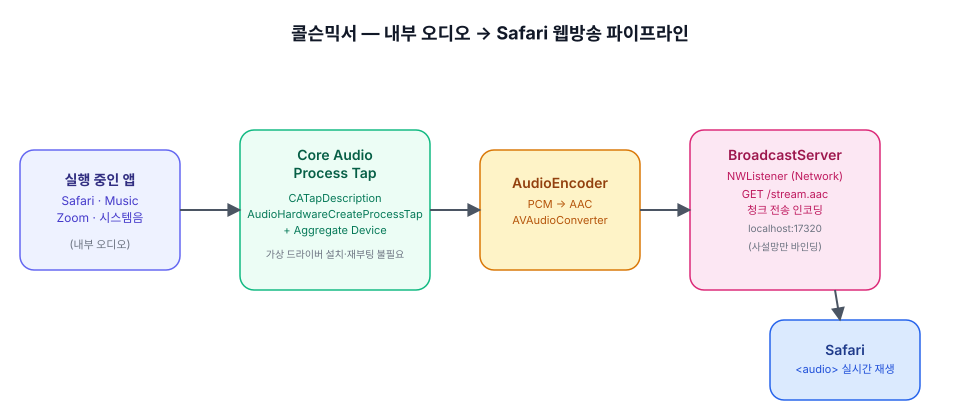
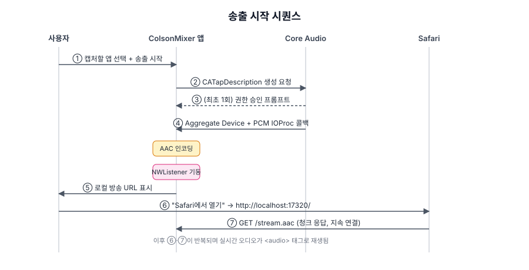
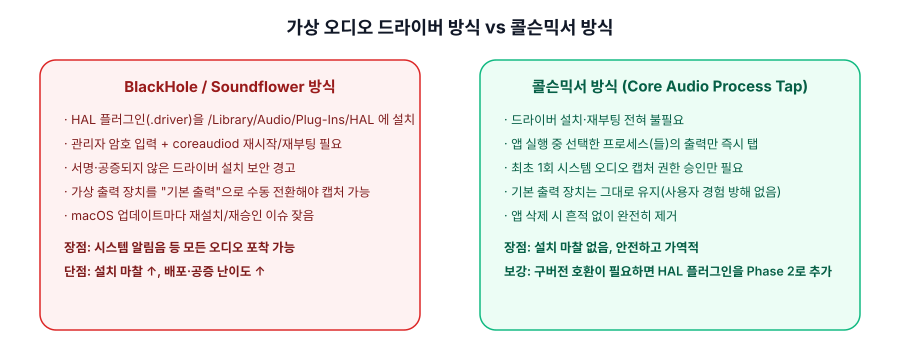

# 콜슨믹서 (ColsonMixer)

macOS에서 재생 중인 **내부 오디오를 캡처해 Safari로 실시간 웹방송처럼 송출**하는 경량 유틸리티입니다. BlackHole·Soundflower처럼 가상 오디오 드라이버를 설치할 필요가 없습니다.

> 상태: MVP 구현 완료 — macOS 빌드 통과, 앱 정상 기동 확인. 시스템 오디오 녹음 권한 승인과 실제 Safari 재생은 사람이 직접 눌러봐야 해서 아직 실기 검증 전입니다. 자세한 내용은 [테크 PRD](Docs/PRD.md)와 [태스크 문서](Docs/TASKS.md)를 참고하세요.

## 왜 만드는가

macOS는 보안상 앱이 다른 앱·시스템 전체의 내부 오디오를 임의로 녹음하는 것을 기본적으로 막아 둡니다. 그래서 흔히 쓰는 해결책이 BlackHole·Soundflower 같은 **가상 오디오 드라이버**를 설치하는 것인데, 이 방식은 관리자 권한, 재부팅, 서명되지 않은 드라이버 설치 경고 같은 마찰이 따릅니다.

콜슨믹서는 macOS가 제공하는 최신 **Core Audio Process Tap API**(`CATapDescription` / `AudioHardwareCreateProcessTap`)를 사용해, 드라이버 설치나 재부팅 없이 선택한 앱(또는 시스템 전체)의 오디오를 직접 캡처합니다. 캡처한 소리는 AAC로 인코딩되어 앱 내장 HTTP 서버를 통해 흘러나가고, Safari에서 주소를 열면 인터넷 라디오처럼 실시간으로 들을 수 있습니다.

| | BlackHole / Soundflower | 콜슨믹서 |
|---|---|---|
| 드라이버 설치 | 필요 (`/Library/Audio/Plug-Ins/HAL`) | 불필요 |
| 재부팅 | 필요한 경우 많음 | 불필요 |
| 기본 출력 장치 변경 | 필요 | 불필요 |
| 포착 범위 | 시스템 전체(알림음 포함) | 선택한 앱 또는 시스템 전체 |

더 자세한 비교는 [Docs/PRD.md](Docs/PRD.md#2-조사한-해결-방법-비교)를 참고하세요.

## 동작 방식

```
실행 중인 앱(들)  →  Core Audio Process Tap  →  AAC 인코더  →  로컬 HTTP 방송 서버  →  Safari
   (내부 오디오)        + Aggregate Device                      (NWListener, 청크 스트리밍)      <audio> 재생
```



1. 사용자가 콜슨믹서 창에서 캡처할 앱(또는 "시스템 전체")을 선택하고 "송출 시작"을 누릅니다.
2. `CATapDescription`으로 탭을 구성하고 애그리게이트 장치를 만들어 PCM 오디오를 실시간으로 수신합니다. 최초 1회 macOS가 시스템 오디오 녹음 권한을 묻습니다.
3. 수신한 PCM을 ADTS 프레이밍된 AAC로 인코딩합니다.
4. 내장된 초경량 HTTP 서버(`NWListener`, 127.0.0.1:17320부터 순차 탐색)가 `/stream.aac`에 청크 전송으로 오디오를 계속 흘려보냅니다.
5. "Safari에서 열기"를 누르면 표시된 로컬 주소가 열리고, 표준 `<audio>` 태그로 실시간 재생됩니다.

전체 시퀀스는 아래 다이어그램을 참고하세요.



## 왜 가상 드라이버 없이도 가능한가

macOS Sonoma(14.4) 이후 Apple은 다른 프로세스의 오디오 출력을 직접 탭(tap)할 수 있는 공식 Core Audio API를 제공합니다. 콜슨믹서는 이 API를 1차 구현으로 채택하고, 시스템 알림음까지 전부 포착해야 하는 특수한 경우를 위한 전통적 HAL 드라이버 방식은 향후 과제(Phase 2)로 남겨 두었습니다.



## 실행 방법

1. `CoulsonMixer.xcodeproj`를 Xcode로 열고 "My Mac" 대상으로 실행합니다 (멀티플랫폼 타깃이지만 오디오 캡처 기능은 macOS에서만 동작합니다).
2. 캡처 대상(시스템 전체 또는 특정 앱)을 고르고 "송출 시작"을 누릅니다. 최초 실행 시 시스템 오디오 녹음 권한 승인 창이 뜨면 허용해 주세요.
3. "Safari에서 열기"를 누르거나 표시된 주소를 Safari에 직접 입력하면 실시간으로 재생됩니다.

> App Sandbox는 MVP 단계에서 비활성화되어 있습니다 (사유는 [Docs/PRD.md의 권한 및 보안 섹션](Docs/PRD.md#5-권한-및-보안-고려사항) 참고).

## 기술 스택

- **SwiftUI** — 메뉴바 상주 UI, 송출 On/Off, 소스 선택
- **Core Audio** — `CATapDescription`, `AudioHardwareCreateProcessTap`, Aggregate Device
- **AVFAudio** — `AVAudioConverter` 기반 실시간 AAC 인코딩
- **Network** — `NWListener` 기반 로컬 HTTP 청크 스트리밍 서버

## 문서

- [테크 PRD](Docs/PRD.md) — 문제 정의, 조사한 해결 방법 비교, 채택 아키텍처, 권한/보안 고려사항
- [태스크 문서](Docs/TASKS.md) — Phase별 구현 작업 목록

## 로드맵

MVP는 앱 1개(또는 시스템 전체) 캡처 → AAC → 로컬 HTTP 스트리밍 → Safari 재생까지입니다. 이후 과제는 [Docs/TASKS.md의 Phase 7](Docs/TASKS.md#phase-7--향후-과제-스트레치-골)을 참고하세요: HAL 드라이버 폴백, ICY 메타데이터, 다중 소스 믹싱, WebRTC 저지연 경로.

## 개인정보 보호

콜슨믹서는 오디오를 디스크에 저장하거나 외부 인터넷으로 전송하지 않습니다. 방송 서버는 기본적으로 로컬호스트에만 바인딩되며, 같은 네트워크의 다른 기기에서 듣고 싶을 때만 사용자가 명시적으로 켜는 옵션입니다.
